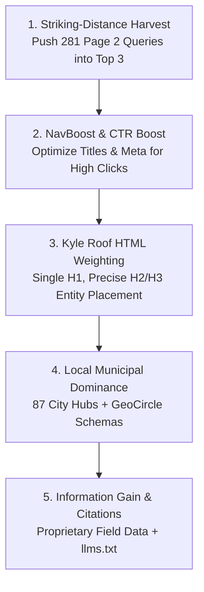

# 🏆 Executive Master Dossier: The #1 Google Search Ranking Roadmap

> __Primary Objective__: Rank Foresight Home Inspections #1 across Metro Atlanta for high-intent buyer and commercial inspection searches.  
> __Last Updated__: November 14, 2026 — Canonical Truth v2026.10.20  
> __Repository__: `C:\Users\fores\.gemini\antigravity\scratch\foresight-website`  
> __Production Domain__: `https://www.fhinspectionsatl.com`  
> __Current Git Head__: Clean, verified, and synced with `data/truth.json`

---

## 🎯 1. Current Search Baseline & The Path to #1

Based on live Google Search Console API synchronization:
- __Page 1 Queries (Positions 1–10)__: __196 queries__ (+21.0% recent surge).
- __Striking-Distance Queries (Positions 11–20)__: __281 queries__ sitting on Page 2 ready to be pushed to Page 1 and #1.
- __Top 20 Total Search Footprint__: __477 queries__ (+22.9% expansion).
- __Brand Search (`"foresight home inspections"`)__: __Rank #2.8__ (13.3% CTR, climbing to #1).
- __Clicks on Core Pages__: Up +19.6% month-over-month.

---

## 🚀 2. The 5-Phase Action Plan to Win #1 Rankings

### Phase 1: The Striking-Distance Climber (Pos 11–20 $\to$ #1–3)
- Target the 281 high-intent queries sitting just off Page 1 (e.g. city + "home inspection", "cost of home inspection Atlanta", "sewer scope inspection Atlanta", "pool inspection Atlanta").
- Surgical injection into existing landing page H2/H3 tags, FAQ schema accordions, and internal link anchor text without keyword stuffing.

### Phase 2: NavBoost Click-Stream & CTR Optimization (Lily Ray Standard)
- Google's 13-month NavBoost cycle rewards pages with above-average click-through and high dwell time ("Good Clicks").
- Audit title tags (<60 characters) and meta descriptions (<158 characters) on top landing pages with commercial value hooks:
  - _"Atlanta Home Inspections from $345 | 2-Inspector Team | $10k Warranty"_
  - Front-load target entities; eliminate vague branding titles.

### Phase 3: Mathematical Single-Variable HTML Weighting (Kyle Roof US Patent 10,540,263 B1)
- Strict algorithmic placement hierarchy: __Meta Title Tag > H1 > URL Slug > H2/H3 > First 100 Words > Body Paragraphs__.
- Guarantee exactly one H1 per page; eliminate decorative headings; ensure semantic markup.

### Phase 4: Hyper-Local SAB Dominance (Whitespark / Darren Shaw Standard)
- Deep municipal radius schemas (`GeoCircle`, exact GPS coordinates for all 87 cities).
- Permanent Google Maps Place ID and CID linkage (`hasMap`).
- Review velocity integration and review schema markup (`4.8★ / 53 reviews`).

### Phase 5: Information Gain & AI Citations (Bernard Huang US Patent 10,956,488 B2)
- Zero generic boilerplate. Infuse proprietary field data: exact infrared thermal differential ($\Delta T$), local building code quirks (Fulton, DeKalb, Cobb, Gwinnett), and Certified Master Inspector field notes.
- Grounding via `/llms.txt`, `/llms-full.txt`, and Web MCP endpoints (`/api/mcp`).

---

## 🛠️ 3. Technical SEO Health & Zero-Error Architecture

- __Clean Static Compilation__: 1,216 pure static HTML pages with 0 build errors.
- __GSC Indexing Clean__:
  - `robots.js`: Disallow of `/opengraph-image` permanently removed; all images and meta previews crawlable.
  - 404 Errors: 35+ permanent 301 redirects deployed in `next.config.mjs` for all legacy URL variants.
- __WCAG 2.1/2.2 AA Compliance__: High-contrast ratios, semantic landmarks, full keyboard navigability, zero layout thrashing.
- __Mobile Speed__: Zero forced reflows, dynamic client chunking for heavy modals, lazy-loaded below-fold images.

---

## 💰 4. Inviolable Commercial Pricing (Must Be Preserved Across All SEO Edits)

- Single-family home inspections (Buyer, Pre-Listing, 11-Month Warranty): Starting from __$345__ (condos/townhomes from __$295__)
- Phase 1 Pre-Drywall framing inspections: Starting from __$275__
- Final New Construction inspections: Starting from __$400__
- Repair Re-Inspections: __$200__
- Complexity add-on fees (Unfinished Crawlspace, Unfinished Basement, 50+ yr Vintage Home): __+$75 each__
- Maximum Discount: __-$25__ (Strictly Verified Licensed Georgia Realtors Only with active GREC License number)
- Auxiliary & Commercial Services (Sewer Scope, Radon Gas Testing, Pool & Spa, DeKalb County Low-Flow Compliance, Georgia Termite / WDO, Mold & Air Quality Lab Analysis, Short-Term Rental Compliance, Commercial PCA, Itemized Contractor Repair Cost Estimates): Strictly __Call (678) 480-2110 for Quote__
- Business address (`1816 South Deshon Road, Lithonia, GA 30058`) hidden in visible UI; present only in structured schema.
- Sunday: By appointment only.

---

## 🤖 5. Active Autonomous Background Tasks

1. __Daily Due Diligence & Loan Officer Scouting__ (`Daily 08:00 UTC`)
2. __Weekly SEO Dominance Engine__ (`Mondays 09:00 UTC`)
3. __Monthly Strategic Growth Engine__ (`1st of Month 10:00 UTC`)

---

## 🎯 6. Immediate Action Items for the New Chat

1. Run `python scripts/page1-guard.py` and extract the highest-volume striking-distance queries from GSC.
2. Surgically optimize the top 5 landing pages (Homepage, `/services`, `/services/sewer-scope-inspection`, `/services/radon-testing`, `/services/pool-spa-inspection`) to capture #1 positions.
3. Review title tag and CTR improvements for the core Atlanta municipal hubs.
